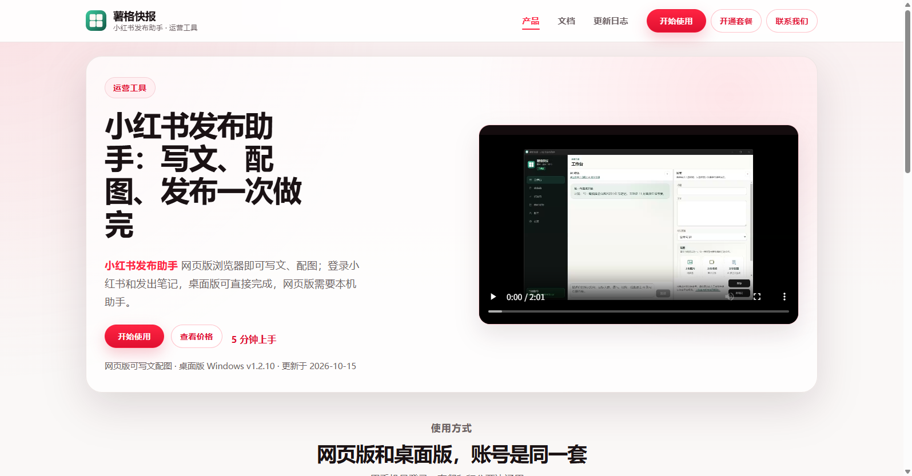
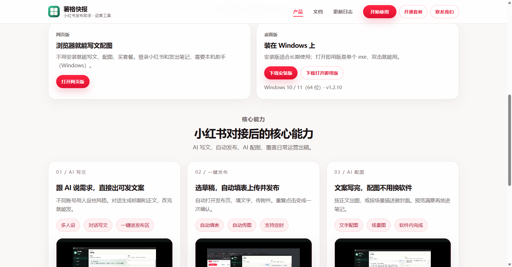

  

<h1 align="center">薯格快报 · 小红书发布助手</h1>

  AI 写文配图、本机扫码发布、定时发布、自动运营 
  网页版和 Windows 桌面版，账号同一套

  
  
  
  
  

  <a href="https://xhs-1343023899.cos.ap-beijing.myqcloud.com/releases/latest/xhs-setup.exe"><b>下载安装版</b></a>
  ·
  <a href="https://xhs-1343023899.cos.ap-beijing.myqcloud.com/releases/latest/xhs-portable.exe"><b>下载打开即用版</b></a>
  ·
  <a href="https://sgkb.yunqingkeji.site"><b>打开网页版</b></a>

> 本仓库是产品介绍页，**不含源码**。安装包走官网 CDN，不放在 GitHub 上。

## 这是什么

[薯格快报](https://yunqingkeji.site) 是面向通用行业的 **小红书发布助手**。写文、配图、发笔记在同一套工作台里完成，不用在浏览器、文档和作图软件之间来回切。

- **网页版**：浏览器就能写文、配图、买套餐
- **桌面版**：Windows 安装后，登录小红书和发布都在本机完成
- 网页版要发笔记时，再打开本机助手即可；两边用同一个手机号

## 下载

| 方式 | 说明 | 链接 |
| --- | --- | --- |
| 网页版 | 不用安装，浏览器写文配图 | [sgkb.yunqingkeji.site](https://sgkb.yunqingkeji.site) |
| 安装版 | 适合长期使用 | [xhs-setup.exe](https://xhs-1343023899.cos.ap-beijing.myqcloud.com/releases/latest/xhs-setup.exe) |
| 打开即用版 | 单个 exe，双击就能用 | [xhs-portable.exe](https://xhs-1343023899.cos.ap-beijing.myqcloud.com/releases/latest/xhs-portable.exe) |

桌面版目前支持 **Windows 10 / 11（64 位）**。安装包偏大是正常的，里面带了发布用的浏览器。

杀毒软件有时会拦登录窗口：把软件目录加白名单后重启再试。

## 功能

**AI 写文**
- 多人设：每个账号可以有不同身份、读者和语气
- 对话写文：说清主题，直接出标题和正文，一键进发布区
- 图生文、文档生文：看图写，或读 txt / md / docx / pdf 再写

**AI 配图和短视频**
- 文字封面、场景图、图生图，都在软件里完成
- 可按正文出 5 秒 / 10 秒短视频（发小红书常用竖版）
- 一篇笔记里，图文和视频二选一

**本机发布**
- 扫码登录小红书，可同时挂多个账号
- 选草稿后自动填表、传图或视频、完成发布
- 草稿箱分组、搜索、导入导出
- 定时发布：到点自动发（电脑要开着，软件保持运行）
- 自动运营：配一次人设和素材，按周出稿发布

**账号和积分**
- 手机号注册，套餐和积分跟号走，换电脑不用重新买
- 包月期内 AI 对话免费；出图、出视频按次扣积分

演示视频：[AI 写文](https://xhs-1343023899.cos.ap-beijing.myqcloud.com/videos/Character.mp4) · [自动发布](https://xhs-1343023899.cos.ap-beijing.myqcloud.com/videos/auto.mp4) · [AI 配图](https://xhs-1343023899.cos.ap-beijing.myqcloud.com/videos/ai_image.mp4)

## 账号安全怎么做的

我们不承诺「用了就不会被限流或封号」。平台规则、发布频率、内容质量都由你自己把握。和常见脚本/协议号相比，机制上有这些差异：

1. **本机真实浏览器登录**  
   桌面版内置浏览器打开小红书页面，你自己扫码或验证码登录。看起来就是在电脑上登网页，不是模拟一堆接口。

2. **登录态留在你电脑上**  
   小红书密码不会经过我们的服务器。薯格账号（手机号）只用来管套餐和积分。

3. **发布走页面操作**  
   自动打开笔记发布页、填标题正文、上传附件。不是非官方接口，也不是协议号。

4. **该你把关的部分**  
   AI 生成的内容要自己看过再发。发太勤、内容违规、虚假宣传、矩阵滥发，照样可能被限流或封号。投诉、限流、封禁等后果由使用者承担。

第一次建议把可见范围设成「仅自己可见」，跑通流程再改公开。

## 价格

套餐可连续包几个月，一次付清。微信扫码开通。

| 套餐 | 价格 | 每月积分 | 适合 |
| --- | --- | --- | --- |
| Pro | ¥20 / 月 | 700 | 刚开始持续写文 |
| Plus | ¥60 / 月 | 2100 | 稳定发布的个人和小团队 |
| Ultra | ¥200 / 月 | 7000 | 出图、出视频比较频繁 |

包月期内 AI 对话免费。也可以只充积分、不开套餐。明细见 [价格页](https://yunqingkeji.site/pricing)。

## 5 分钟上手

1. 打开 [网页版](https://sgkb.yunqingkeji.site)，或下载桌面版
2. 用手机号 + 短信验证码注册薯格账号
3. 桌面版点侧边栏底部账号条，登录小红书；网页版先打开本机助手再扫码
4. 左边跟 AI 说要写什么，右边补图，勾选账号，点「发笔记」

完整步骤：[快速开始](https://yunqingkeji.site/docs/quick-start)

## 本仓库不含源码

薯格快报是商业软件。这个 GitHub 仓库只放介绍、截图和下载入口，方便检索和核对官网地址。

- 不提供源代码
- 不在 GitHub Release 里放安装包
- 请只从上面的官网和 COS 链接下载
- 使用问题请到官网点「联系我们」，加入 QQ 群 **1105045126**

## 相关页面

- [官网](https://yunqingkeji.site)
- [小红书发布助手](https://yunqingkeji.site/xiaohongshu-fabu-zhushou/)
- [小红书自动发布](https://yunqingkeji.site/xiaohongshu-zidong-fabu/)
- [小红书定时发布](https://yunqingkeji.site/xiaohongshu-dingshi-fabu/)
- [小红书 AI 写文](https://yunqingkeji.site/xiaohongshu-ai-xiewen/)
- [文档中心](https://yunqingkeji.site/docs/)
- [更新日志](https://yunqingkeji.site/changelog/)
- [用户协议](https://yunqingkeji.site/terms/) · [隐私政策](https://yunqingkeji.site/privacy/)
